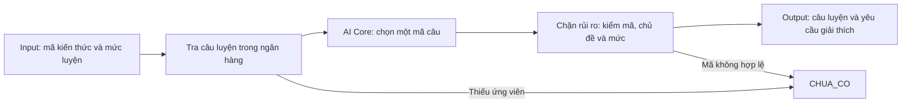

# AI SPEC — Một câu luyện sau câu sai ôn cuối ngày · VibeClaude

> Mốc nộp: §7 chốt chuẩn "đạt" tại **CP2 19:30 Thứ Sáu 27/11** · §0–§7 nộp **CP3 10:00 Thứ Bảy 28/11** · đủ §0–§10 **CP4 14:30 Thứ Bảy 28/11** · §10 changelog ghi tiếp đến **23:59 Thứ Bảy 28/11**.
> Đầu mỗi mục ghi bước guide (`02-guide.md` trong repo đề) chỉ cách điền. Mỗi mục ngắn, có số và nguồn; chi tiết để ở file được trỏ tới. Xoá dòng hướng dẫn trong ngoặc vuông khi điền xong.

Track A (EdTech, A4) — luyện lại một ý kiến thức sau câu sai ở phần ôn cuối ngày.
Data BTC cấp dùng local để tổng hợp số liệu phần ôn cuối ngày. Xem evidence/data-mining.md.

## §0. Hiện tại việc này diễn ra thế nào *(guide 1.1)*
- Luồng hiện tại của việc này, trong khoá hoặc trên app thật (3–5 bước; ảnh chụp từ tài khoản của mình, đã che thông tin):
- Công cụ / AI đang được dùng cho việc này (nếu có) + nguồn. Không kiểm được thì ghi "chưa kiểm":

## §1. Người dùng & bằng chứng *(guide 1.1, 1.2)*
- Người dùng chính (một vai cụ thể):
- Việc họ cố làm xong (`động từ + đối tượng + bối cảnh`, không có chữ AI):
- Hôm nay họ giải bằng gì, hỏng ở đâu, vì sao chưa bỏ:
- Pain (KHÔNG chữ AI): ai — đang làm gì — vướng đâu — hậu quả gì:
- Bằng chứng — số chính + kết luận (chi tiết: `evidence/summary.md`): __

## §2. Impact & quyết định chọn *(guide 1.3)*

| Hướng | Bao nhiêu người gặp | Bao nhiêu lần / tháng | Mỗi lần tốn gì | Impact / tháng | Làm kịp không | Chọn? |
|---|---|---|---|---|---|---|
|  |  |  |  |  |  |  |
|  |  |  |  |  |  |  |
|  |  |  |  |  |  |  |

- **Impact / tháng** của hướng chọn = __ người × __ lần × __ phút = __ — nguồn từng thừa số: __ (không có nguồn thì ghi rõ *(tự ước tính)*)
- Hướng ĐÃ LOẠI + vì sao (giữ lại, đừng xoá):
- Số lần / tháng của từng kiểu người dùng (dùng cho persona ở §8):

## §3. Giải pháp tương tự *(guide 2.1)*
- [sản phẩm / tính năng gần giống]: một điều đáng học · một điều đáng né · mình khác gì

## §4. Thiết kế *(guide 2.2, 3.2)*

- **Lát cắt** giữ như CP1. Học viên nhận một câu luyện cùng kiến thức trong tình huống khác. Output nhắc học viên giải thích lựa chọn.
- **Hình dạng** workflow cố định. Việc tra ứng viên và kiểm mã chạy bằng code, model chọn một câu trong danh sách. Công cụ chỉ đọc ngân hàng local.
- **Ngoài phạm vi** chấm tự động, cập nhật điểm LMS, truy cập log cá nhân.

| Công cụ | Input | Output | Tác động ra ngoài |
|---|---|---|---|
| practice_candidates | Mã kiến thức | Mã câu, mức và nội dung ứng viên | Không |

- G10: đầu vào sai, thiếu ứng viên hoặc kết quả model không hợp lệ đều trả CHUA_CO.
- Đáp án chuẩn nằm riêng trong ngân hàng. Model chỉ nhận nội dung ứng viên, mã và mức. Học viên tự nhập lời giải khi thử với nhóm, người chấm đối chiếu rubric.
- CP2 chạy mock có đánh dấu model fake và token bằng 0. CP3 thay mock bằng API thật tại cùng điểm gọi.

## §5. Chỗ khó — 4 lớp + ≥6 kịch bản + 2 tấn công *(guide 2.3)*

| Kịch bản | Lớp (1–4) | Hành vi mong muốn (nói gì, hiện gì, cho làm gì tiếp) | Câu thử |
|---|---|---|---|
|  |  |  |  |
| *(tấn công)* |  |  |  |
| *(tấn công)* |  |  |  |

(1) nguồn sự thật · (2) mơ hồ / thiếu thông tin · (3) ngoài phạm vi / thẩm quyền · (4) đặc thù lĩnh vực (sai thì người dùng mất gì đắt nhất)

## §6. Bốn đường đi của trải nghiệm
- Mọi thứ suôn sẻ: · Không chắc (lớp 2): · Không có căn cứ (lớp 1): · Người dùng sửa:
- Bị đòi ngoài phạm vi (lớp 3): · Trường hợp đặc thù lĩnh vực (lớp 4):

## §7. Đánh giá & chuẩn "đạt" *(guide 2.4, 4.1)*

- Data card: [data/DATA_CARD.md](data/DATA_CARD.md). Benchmark: [eval/benchmark.csv](eval/benchmark.csv), 20 ca gồm 9 thường, 7 khó và 4 từ chối. Có 7 ca bắt nguồn từ mã kiến thức có lượt sai thật. Câu luyện tự soạn.
- Chuẩn nhóm dùng để chốt CP2: đạt khi **≥90% ca tổng thể qua**, **≥90% ca thường/khó chọn đúng mã và hiện đúng câu**, **100% ca từ chối xử lý đúng**, và **≥90% ca thường/khó hiện yêu cầu giải thích**. Với bộ hiện tại tương ứng tối thiểu 18/20 tổng, 15/16 chọn đúng, 4/4 từ chối và 15/16 có câu luyện kèm yêu cầu giải thích. Xem [metric_spec.yaml](eval/metric_spec.yaml).
- Khi thử với học viên, dùng tình huống mới cùng mã kiến thức và ghi tỷ lệ đạt trên số người thử. Chỉ ghi đạt khi câu trả lời và lời giải thích đều nêu đúng ý cốt lõi theo rubric. Chưa có kết quả với học viên. Phép đo này được báo riêng với benchmark chọn câu.
- Kết quả API thật: đo từ CP3. Kiểm tra mock CP2: 20/20 ca, gồm 16/16 chọn đúng và có yêu cầu giải thích, 4/4 từ chối. Kết quả mock chỉ kiểm tra luồng.

## §8. Chi phí khi dùng thật *(guide 4.2)*
- Persona + giá: `cost/personas.yaml` · lượt mô phỏng: `cost/simulate-__.csv` (__ phiên)
- Chi phí / task thành công: __ (model __) · __ (model __)
- Chi phí / tháng ở quy mô thật: thấp __ · cơ sở __ · cao __ → chi tiết `cost/cost-estimate.md`
- So với impact / người / tháng (§2): đáng làm không, vì sao:

## §9. Rủi ro & an toàn
- Dữ liệu: đã ẩn danh gì, không thu gì, không đưa gì vào model gói miễn phí:
- AI **không được** làm gì kể cả khi người dùng yêu cầu:
- Ai có thể bị hại nếu AI sai, và nhóm chặn thế nào:

## §10. Phân công & changelog
- Phân công có tên (theo chặng, chia cặp — guide "Cách chia việc"): __
- Dùng AI vào việc gì (2–3 dòng; chi tiết `docs/ai-usage.md`):
- Nhật ký thay đổi — **mọi thay đổi sau CP2 19:30 Thứ Sáu 27/11 phải có dòng ở đây**:

**CP2 → CP4** (vd thu hẹp lát cắt, hỏi thêm người dùng, lần cải tiến trước lượt 2)

| Thời điểm | Đổi gì | Vì sao (trỏ về câu thử / lỗi / bằng chứng nào) |
|---|---|---|
|  |  |  |

**Sau CP4 (đến 23:59 Thứ Bảy 28/11)** (sửa theo góp ý — không sửa chuẩn "đạt", câu thử, số bằng chứng, kết quả các lượt đã chạy)

| Thời điểm | Đổi gì | Vì sao |
|---|---|---|
|  |  |  |
